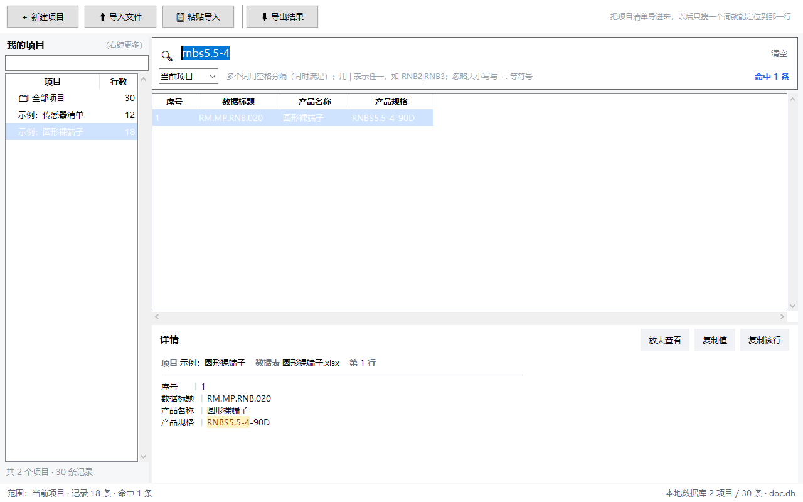
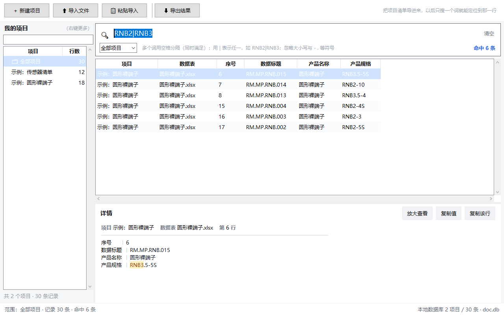
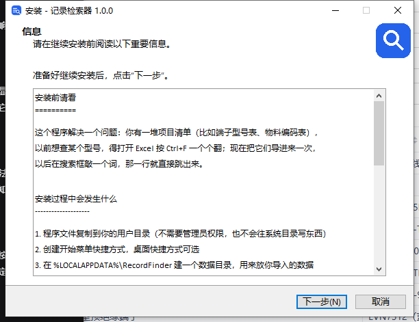

# 记录检索器（record-finder）

[](https://github.com/rockyanyan/record-finder/releases/latest)
[](https://github.com/rockyanyan/record-finder/actions/workflows/ci.yml)
[](LICENSE)
[](#)

把项目清单（Excel / CSV / 网页表格）导进来，以后**只搜一个词**就能定位到对应的那一行。

界面是一个本地小程序：左边是项目，右边是搜索框 + 结果表 + 详情区。所有数据存在本机 SQLite
文件里，不联网、不上传。

> 场景举例：手上有一份几百行的端子型号表，想查 `RNBS5.5-4-90D` 对应哪个编码。
> 不用再打开 Excel 按 Ctrl+F 一个个翻——导进来一次，以后敲 `rnbs5.5-4` 就直接跳出来。

## 下载

到 [Releases](../../releases/latest) 页面下载最新版本：

| 形式 | 文件 | 适合 |
| --- | --- | --- |
| **安装程序**（推荐） | [`record-finder-1.0.0-setup.exe`](../../releases/download/v1.0.0/record-finder-1.0.0-setup.exe)（约 14.7 MB） | 日常使用：装完有开始菜单/桌面图标，可在「设置 → 应用」里卸载 |
| 绿色单文件 | [`record-finder-1.0.0-portable.exe`](../../releases/download/v1.0.0/record-finder-1.0.0-portable.exe)（约 13.0 MB） | 拷到 U 盘随身带、免安装、数据跟着文件夹走 |

系统要求：Windows 10 / 11（64 位）。不需要预装 Python。

> 分发包未做代码签名，首次运行 Windows SmartScreen 可能提示「未知发布者」，点「更多信息 → 仍要运行」即可。



搜 `rnbs5.5-4` 直接命中 `RNBS5.5-4-90D`，详情区黄色高亮命中片段。



---

## 为什么这么搜能搜到

导入时会把每一行「折叠」一份索引：把全角转半角、大小写统一、并把 `- . / _ 空格` 这类符号去掉。
所以下面这些写法都能命中 `RNBS5.5-4-90D`：

| 你输入 | 结果 |
| --- | --- |
| `rnbs5.5-4` | ✅ 忽略大小写与连字符 |
| `RNBS554` | ✅ 符号被折叠 |
| `RNBS5.5-4-90D` | ✅ 完全匹配，排在最前 |
| `圆形裸端子` | ✅ 任意列命中 |
| `裸端子 5.5` | ✅ 空格表示「同时包含」 |
| `RNB2\|RNB3` | ✅ `\|` 表示「任一」 |

排序规则：整格完全相同 > 从开头匹配 > 包含，命中越多、越精确越靠前。

---

## 三种导入方式

1. **导入文件** — 选 `.xlsx / .xlsm / .csv / .tsv / .txt`，自动识别表头、去掉全空行全空列、
   合并重复行。多工作表会拆成多张表，同一个项目下可以放多张表。
2. **粘贴导入** — 从网页或 Excel 里框选复制（例如你截图里那种材料清单表格），
   点「粘贴导入」贴进去，自动按制表符/竖线/多空格切列，右下角实时显示「将导入 N 行 × M 列」。
3. **命令行** — 适合批量或脚本调用，见下。

导入时如果没选项目，会自动用文件名新建一个项目。

---

## 常用操作

| 操作 | 位置 |
| --- | --- |
| 新建 / 重命名 / 复制 / 删除项目 | 左侧列表右键，或「项目」菜单 |
| 管理一个项目下的多张表 | 右键 →「管理数据表…」 |
| 跨项目搜索 | 左上角范围切到「全部项目」 |
| 复制整行 / 复制某格 | 结果表右键按钮，或 `Ctrl+C` 复制整行 |
| 导出结果 / 导出整张表 | 「导出结果」，支持 CSV（Excel 双击不乱码）和 .xlsx |
| 备份 | 文件 →「备份数据库…」，把 .db 拷走即可迁移 |

快捷键：`Ctrl+F` 搜索 · `Ctrl+N` 新建项目 · `Ctrl+O` 导入 · `Ctrl+E` 导出 · `F5` 重新搜索 · `Esc` 清空。

---

## 命令行

```bat
记录检索器.exe --cli import 端子清单.xlsx 端子项目
记录检索器.exe --cli search "rnbs5.5-4"
记录检索器.exe --cli projects
```

也可以用环境变量指定数据库位置，便于做多套数据：

```bat
set RECORD_FINDER_DB=D:\data\物料库.db
记录检索器.exe
```

---

## 安装程序

双击下载到的 `record-finder-1.0.0-setup.exe`，一路「下一步」即可。



几点设计上的取舍：

- **不弹 UAC**：默认装到 `%LOCALAPPDATA%\Programs\RecordFinder`，普通用户直接装完。
  想装到 Program Files 也可以用命令行 `/DIR="C:\Program Files\RecordFinder"`，那样才会提权。
- **升级不丢数据**：直接装新版本覆盖即可，`AppId` 相同，程序文件替换但数据不动。
- **卸载会问你要不要删数据**，默认选中「否」，避免手滑删掉积累的清单。
- **静默安装**：`record-finder-1.0.0-setup.exe /VERYSILENT /NORESTART`，适合批量部署。

---

## 数据存在哪

程序会区分自己是被安装的、还是绿色运行的：

| 运行方式 | 数据位置 |
| --- | --- |
| 安装版（有注册表项） | `%LOCALAPPDATA%\RecordFinder\record-finder.db` |
| 绿色版（无注册表项） | exe 同目录 `data\record-finder.db`，可随身携带 |
| 显式指定 | 环境变量 `RECORD_FINDER_HOME` 或 `RECORD_FINDER_DB` |

菜单「帮助 → 数据库位置」能看到完整路径，「帮助 → 打开数据文件夹」直接跳转。
把这个 `.db` 拷走就能带走全部数据。

> 为什么安装版不能把数据放程序目录：那个目录卸载时会被清空。
> 早期版本在这里踩过坑（装在用户目录时目录恰好可写，数据就落在里面了），
> 现在靠注册表里的 `DataPath` 显式区分，并有单元测试兜住。

---

## 从源码运行 / 重新打包

```bat
python main.py                                   :: 直接跑界面
python -m pytest tests -q                        :: 核心逻辑测试（13 个用例）
python tools/make_samples.py                     :: 生成样例数据
python tools/make_icon.py                        :: 生成程序图标
python tools/make_wizard.py                      :: 生成安装向导图片

python -m PyInstaller record-finder.spec --noconfirm    :: 打包绿色版 exe
python tools/verify_exe.py                              :: 验收 exe

ISCC.exe installer\record-finder.iss                    :: 编译安装程序
python tools\verify_installer.py                        :: 验收安装/升级/卸载全流程
python tools\shot_installer.py                          :: 逐页截安装向导
```

编译安装程序需要 [Inno Setup 6](https://jrsoftware.org/isdl.php)（`winget install JRSoftware.InnoSetup`）。
中文语言包已放在 `installer/languages/ChineseSimplified.isl`，无需另行下载。

目录结构：

```
record-finder/
├─ main.py                  程序入口（GUI / --cli）
├─ record-finder.spec       PyInstaller 打包配置
├─ version_info.txt         exe 的版本资源
├─ src/
│  ├─ app.py                tkinter 界面
│  ├─ search.py             折叠匹配、查询语法、打分、高亮定位
│  ├─ importer.py           Excel/CSV/粘贴文本 → 规整的二维表
│  ├─ store.py              SQLite 存储 + 安装版/绿色版数据目录判定
│  ├─ exporter.py           导出 CSV / xlsx
│  ├─ samples.py            内置示例数据
│  └─ __init__.py
├─ installer/
│  ├─ record-finder.iss     安装脚本
│  ├─ assets/               向导图片、安装前说明、许可说明
│  └─ languages/            简体中文语言包
├─ samples/                 样例表格
├─ tests/test_core.py       13 个核心用例
└─ tools/                   素材生成、GUI 冒烟、exe/安装包验收脚本
```

---

## 已知边界

- Excel 只支持 `.xlsx / .xlsm`；老的 `.xls` 请先另存为 xlsx。
- 结果表最多渲染 5000 行（命中更多时按相关度截断，底部会提示实际条数）；导出不受此限制。
- 单文件 exe 首次启动需要解压到临时目录，冷启动约 1～2 秒属正常。
- 安装包未做代码签名，首次运行 SmartScreen 可能提示「未知发布者」，选择「仍要运行」即可。
- 只支持 Windows；界面基于 tkinter，没有做 macOS / Linux 适配。

---

## 许可

[MIT](LICENSE)

第三方组件：Python 运行时（PSF License）、openpyxl（MIT）、Inno Setup（仅用于生成安装包）。

